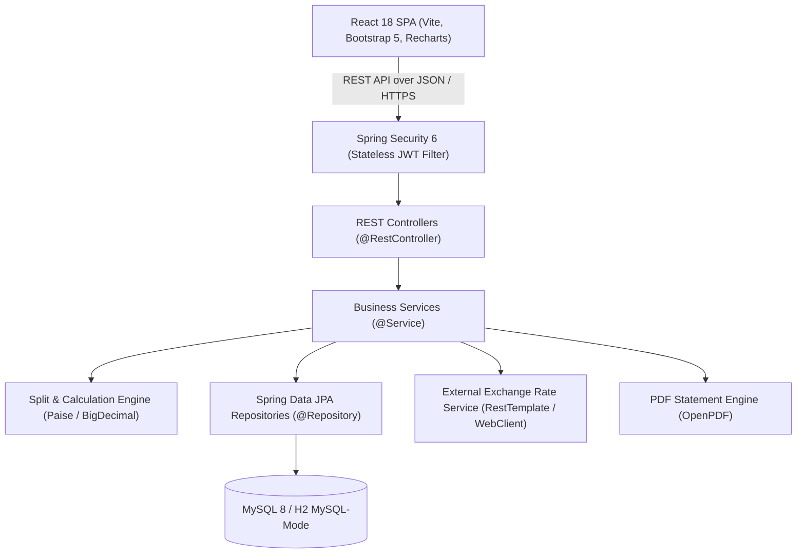

# FinMate – System Architecture & Engineering Specifications

This document outlines the architectural principles, domain designs, data models, financial math invariants, and security implementations behind the **FinMate Smart Personal Finance & Expense Management Platform**, developed strictly according to the 96-page FinMate PRD v1.0.

---

## 1. Architectural Philosophy & Layered Design

FinMate follows a clean, modular multi-tier architecture separating business rules, persistence logic, security gates, and presentation concerns:

### Layer Responsibilities
1. **Controllers (`com.finmate.*.controller`)**: Thin presentation boundary. Handles HTTP serialization, path variable extraction, query parameters, `@Valid` bean validation, and delegating to services. Returns standard `ResponseEntity<T>`.
2. **Services (`com.finmate.*.service`)**: Core business workflows, transaction boundaries (`@Transactional`), security authorization checks, audit logging, and calculations.
3. **Calculation Engines (`com.finmate.expense.split`, `*.service.*Engine`)**: Pure, decoupled mathematical algorithms with zero side-effects. Tested independently with high-coverage unit tests.
4. **Repositories (`com.finmate.*.repository`)**: Spring Data JPA repositories with custom JPQL queries, pagination (`Pageable`), and pessimistic/optimistic locking where necessary.
5. **Entities (`com.finmate.*.entity`)**: Relational database mapping with JPA annotations. Entities inherit from `BaseEntity` (`createdAt`, `updatedAt`, `version` for optimistic locking).
6. **Frontend SPA (`frontend/src`)**: Feature-sliced React architecture with custom design tokens, centralized Axios client with 401 transparent token refresh queue, tabular-number typography, and responsive Bootstrap layouts.

---

## 2. Authentication & Security Architecture

### 2.1 Stateless Dual-Token Lifecycle
FinMate implements industry-standard JWT authentication with short-lived access tokens and rotating refresh tokens:
- **Access Token**: HMAC-SHA512 (`HS512`) signed JWT containing subject user ID and role claim (`ROLE_USER`, `ROLE_ADMIN`). Lifetime: **30 minutes** (`1800000ms`).
- **Refresh Token**: 256-bit cryptographically secure random token generated via `SecureRandom` and encoded with Base64 URL-safe. Lifetime: **7 days** (`604800000ms`).
- **Refresh Token Rotation (RTR)**: When an access token expires, the client sends the refresh token to `POST /api/v1/auth/refresh`. The server invalidates the old refresh token, marks it revoked, and issues a brand new access token and fresh refresh token.
- **Brute-Force & Account Protection**: Passwords are encrypted using Spring Security's `BCryptPasswordEncoder` with strength factor 12. Password reset links utilize expiring single-use cryptographic tokens.

### 2.2 Role-Based Access Control (RBAC)
- `ROLE_USER`: Standard user privileges (manage personal transactions, budgets, goals, recurring rules, and participate in expense groups).
- `ROLE_ADMIN`: Administrative privileges (access system health and user analytics, toggle user account active/suspended status, and manage system default categories). Attempted access by `ROLE_USER` returns an explicit `403 Forbidden`.

---

## 3. Financial Precision Engine & Zero Floating-Point Arithmetic

### 3.1 Currency Policy
To prevent IEEE-754 binary floating-point representation artifacts (e.g. `0.1 + 0.2 = 0.30000000000000004`), FinMate enforces **zero floating-point math**:
- In the database: `DECIMAL(15, 2)` or `BIGINT` representing minor currency units (paise / cents).
- In Java: `java.math.BigDecimal` with scale 2 and `RoundingMode.HALF_UP`, or integer paise (`long paise = amount.multiply(100).longValueExact()`).
- In JSON responses: Monospace / tabular numbers formatted as fixed strings (`"5000.00"` or `"₹5,000.00"`).

### 3.2 Expense Split Engine (PRD Section 6.4)
The `SplitEngine` handles three split methodologies with penny/paise exact balance:
1. **Equal Split**:
   - Total paise is integer-divided by the participant count: `baseShare = totalPaise / N`.
   - The remainder paise `rem = totalPaise % N` is distributed strictly **1 paisa each** to the first `rem` participants in stable order.
   - Example (PRD Section 6.4): ₹5,000 split among 3 people:
     - 500,000 paise / 3 = 166,666 paise with remainder 2 paise.
     - Participant 1: 166,668 paise = **₹1,666.68**
     - Participant 2: 166,666 paise = **₹1,666.66**
     - Participant 3: 166,666 paise = **₹1,666.66**
     - Sum: ₹1,666.68 + ₹1,666.66 + ₹1,666.66 = **₹5,000.00** (Exact invariant).
2. **Exact Split**:
   - Explicit amounts are provided for each participant.
   - Validation rule: $\sum \text{Split Amounts} = \text{Total Amount}$ down to 0 paise.
3. **Percentage Split**:
   - Percentages must sum to exactly 100.00%.
   - Split amount for each is calculated as `ROUND(total * percent / 100, 2)`. Any rounding residual (paise delta) is adjusted on the largest percentage participant to ensure exact total match.

---

## 4. Group Balances & Debt Minimization Algorithm

### 4.1 Balance Invariant
For every group, the net balance of each member $i$ is calculated as:
$$\text{Net}_i = \text{Paid}_i - \text{Owed}_i + \text{SettledPaid}_i - \text{SettledReceived}_i$$

The mathematical invariant must hold at all times:
$$\sum_{i=1}^{M} \text{Net}_i = 0.00$$

### 4.2 Greedy Debt Simplification
To minimize the total number of inter-member transactions required to settle all debts in a group of $N$ people:
1. Separate participants into **debtors** ($\text{Net} < 0$) and **creditors** ($\text{Net} > 0$).
2. Sort debtors descending by absolute debt magnitude; sort creditors descending by credit magnitude.
3. Greedily match the largest debtor with the largest creditor:
   - Settle $\min(|\text{DebtorNet}|, \text{CreditorNet})$.
   - Update both balances and repeat until all balances are zero.
4. **Result**: Reduces up to $O(N^2)$ pairwise debts to at most $N-1$ optimal settlement transactions.

---

## 5. Budget Calculation & Smart Alerting Engine

For any user and month, the budget engine evaluates category and overall budgets:
- **Utilization Rate**: $\text{Utilization} = \left(\frac{\text{Spent}}{\text{Limit}}\right) \times 100\%$
- **Threshold States**:
  - `SAFE`: $\text{Utilization} < \text{AlertThreshold}$ (default 80%).
  - `WARNING`: $\text{AlertThreshold} \le \text{Utilization} \le 100\%$.
  - `EXCEEDED`: $\text{Utilization} > 100\%$.
- When a user logs a transaction that causes a budget to cross into `WARNING` or `EXCEEDED`, a real-time in-app notification and email alert are queued asynchronously via `@Async` Spring event listeners.

---

## 6. Savings Goals & Available Balance Protection

Savings goals track target progress over time:
- **Progress**: $\text{Completion} = \left(\frac{\text{Saved}}{\text{Target}}\right) \times 100\%$
- **Required Monthly Saving**:
  $$\text{Monthly Saving} = \frac{\text{Target} - \text{Saved}}{\max(1, \text{Months Left})}$$
- **Free Balance Safety Check**:
  Before allowing a contribution, FinMate computes:
  $$\text{Free Balance} = \text{Current Bank Balance} - \text{Active Goal Reserves}$$
  If contribution amount exceeds `Free Balance`, the system warns or prompts the user to prevent overdrafting day-to-day liquidity.

---

## 7. Reporting & PDF Generation Engine

FinMate integrates **OpenPDF 2.0.3** (clean LGPL-compliant fork of iText) for monthly financial statements:
- Native A4 page layout with corporate typography (Helvetica bold headers, light borders, alternating table rows).
- Includes:
  1. Header banner with user credentials, month, and generation timestamp.
  2. Financial KPI summary grid (Income, Expense, Net Savings, Savings Rate %).
  3. Category spending breakdown table with percentages.
  4. Budget targets and variance analysis table.
  5. Active savings goals and completion bars.
- Generated on-the-fly and streamed directly to HTTP response as `application/pdf`.

---

## 8. External API Integration (Dual-Client Architecture)

FinMate provides real-time foreign exchange conversion:
- Primary client: `RestTemplate` with connection and read timeouts (3000ms).
- Secondary client: Spring WebFlux `WebClient` for reactive non-blocking invocation.
- Fallback resilience: If upstream exchange rates API is unavailable or rate-limited, FinMate automatically falls back to static seed exchange rates without disrupting the user experience.

---

## 9. Database Schema & Entities

The platform manages 18 relational tables with full foreign key constraints, indexes, and audit timestamps:
1. `users` – User accounts, authentication credentials, theme and currency preferences.
2. `refresh_tokens` – Secure hashed rotating refresh tokens.
3. `password_resets` – Single-use expiring password recovery tokens.
4. `categories` – System default and user-custom income/expense categories with icons and hex colors.
5. `transactions` – Individual income and expense entries with payment method and tags.
6. `recurring_rules` – Scheduling rules for automated periodic transactions.
7. `recurring_logs` – Execution history audit log of recurring rules.
8. `budgets` – Monthly category-specific and overall budget limits and thresholds.
9. `budget_history` – Archival snapshots of month-end budget statuses.
10. `savings_goals` – Target amounts, deadlines, and milestone flags.
11. `goal_contributions` – Timestamped deposits toward savings goals.
12. `expense_groups` – Shared expense management spaces.
13. `group_members` – Membership mapping with OWNER / MEMBER roles and status.
14. `group_invitations` – Pending email invitations with 7-day token expiration.
15. `shared_expenses` – Group expense entries with payer and split type.
16. `expense_splits` – Individual shares per participant with remainder paise attribution.
17. `settlements` – Inter-member debt payments and confirmation statuses.
18. `notifications` – In-app alerts, budget warnings, and group updates.
